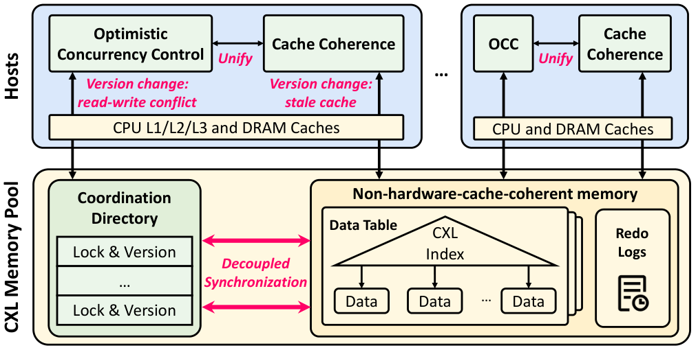

# XTRA: Unifying Cache Coherence and Concurrency Control for Distributed Transactions in a CXL Pod

[返回图集](../README.md) · XTRA · SOSP 2026 · 样本外补充

研究对象：并发与故障语义模型 / XTRA CXL内存池中的分布式事务同步与缓存一致性（SOSP 2026，样本外）

17页作者Git版本，仅收F3完整非实验架构图；样本外补充，不计入固定100篇。其余图未因本次收录而获审核。

读图练习：锁与版本是否必须跟每条数据放在一起？先在 F3 中找到目录与数据表的位置，再用 §3 解释版本变化怎样同时服务于事务冲突检测和过期缓存识别。不同 CXL 版本下目录同步的实现有区别，不能从图中的共享池推断整个池都具备跨主机硬件缓存一致性。

可对照 [vCXLGen F4](asplos-2026-vcxlgen.md#f4)：它追踪本地与全局一致性协议之间的一次消息交互；这里追踪事务同步元数据与应用数据的分离，以及版本信号的复用。二者研究问题不同，不代表同一实现或可直接互换的协议。

版本与许可：[精确作者Git文件](https://github.com/cszjyang/cszjyang.github.io/blob/0e6058eb31c7321ad89b619a6b7bc3ff02622b8f/publications/2026/xtra/SOSP26-XTRA-paper.pdf)，17页，首页可见 CC BY 4.0 与 DOI 10.1145/3830418.3843888。源PDF SHA-256：`40b34fa1dd59b318df3de14a9dc97e355f928618b9fcc96b3a5a7325d89b5ddb`；Git blob：`aa0c709a68468b07bcfb868ceaa3f4b4046976f0`；大小1,666,791字节。已目视检查首页、物理p5、F3图注与§3及最终裁图，未发现本图的第三方署名或许可例外。首页artifact徽章不在裁图内，PDF不随库分发。

## F3

**非实验图 · 同步元数据与应用数据分离架构图**

[原文物理页5](https://raw.githubusercontent.com/cszjyang/cszjyang.github.io/0e6058eb31c7321ad89b619a6b7bc3ff02622b8f/publications/2026/xtra/SOSP26-XTRA-paper.pdf#page=5) · [许可证 CC BY 4.0](https://creativecommons.org/licenses/by/4.0/)

先区分保存锁与版本的 Coordination Directory 和存放应用数据、索引及 redo 日志的非硬件缓存一致性区域，再追踪主机中的并发控制与缓存一致性如何复用版本变化。结合图注与§3：CXL 3.0 的目录同步使用 HCC 原子操作；CXL 2.0 则以软件互斥维持同一抽象，不能把整池都当成硬件一致性内存。此图是架构关系，不是性能或正确性证明。 样本外补充，不计入固定100篇或其分类覆盖完成量。

署名：Zhijun Yang, Yu Hua, Ming Zhang, Menglei Chen, Xumin Chen, Aoyang Tong. XTRA: Unifying Cache Coherence and Concurrency Control for Distributed Transactions in a CXL Pod. SOSP 2026. DOI: https://doi.org/10.1145/3830418.3843888. Copyright 2026 held by the owner/authors. Source: https://github.com/cszjyang/cszjyang.github.io/blob/0e6058eb31c7321ad89b619a6b7bc3ff02622b8f/publications/2026/xtra/SOSP26-XTRA-paper.pdf. Version: 17-page SOSP 2026 author-hosted PDF, Git commit 0e6058eb31c7321ad89b619a6b7bc3ff02622b8f, blob aa0c709a68468b07bcfb868ceaa3f4b4046976f0; not asserted publisher-byte-identical. CC BY 4.0: https://creativecommons.org/licenses/by/4.0/. Whole Figure 3 cropped from the exact author-hosted PDF and rasterized at 300 dpi; caption excluded, all host/pool boundaries, component labels and arrows retained; no redrawing or recoloring. No endorsement implied.

修改说明：Whole Figure 3 cropped from the exact author-hosted PDF and rasterized at 300 dpi; caption excluded, all host/pool boundaries, component labels and arrows retained; no redrawing or recoloring.
