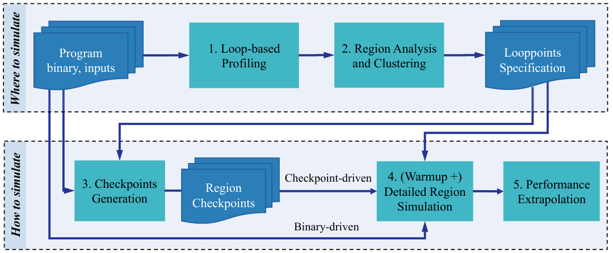
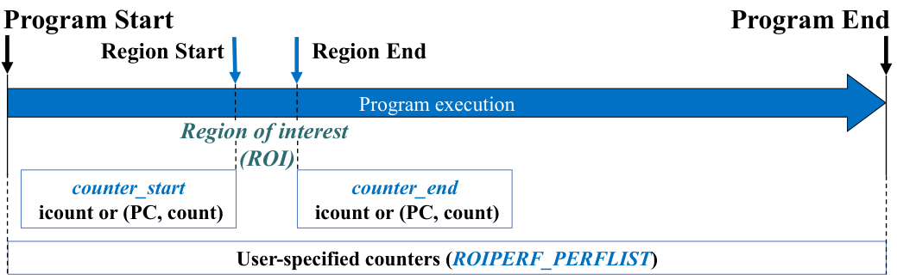

# Accelerating the Simulation of Parallel Workloads using Loop-Bounded Checkpoints

[返回图集](../README.md) · LoopPoint · TACO 2026扩展版 · 样本外补充

研究对象：模拟器与仿真平台 / LoopPoint多线程工作负载抽样模拟与ROIperf硬件验证（TACO扩展版，样本外）

25页TACO 2026扩展作者稿，仅收完整非实验F2/F4；F4是测量机制示意而非结果图。样本外补充，不增加固定100篇覆盖；不混用早期会议版。

F2（物理p5）区间选择与模拟流程 → F4（物理p13）ROIperf真机测量起止边界。

读图练习：F2 中选择代表区间后，哪两条路径进入详细模拟？到了 F4，如何把程序起止和 ROI 起止分开？选择了代表样本，不等于已经确定真机测量的边界。F4 的计数器标记用来界定和读出测量，不能据图形宽度读出实际耗时。

对照 [Nugget v2 导读](../../catalog/README.md#reading-guide-hpca-2026-nugget)：先问样本如何选、验证是否需要迭代，再问真实机器如何定位测量区间。两者不是同一工具，不能据流程相似推定输入、验证方法或误差一致。ROIperf 正文还说明它不能直接监测所有子线程的计数器，TSC 边界时间与逐线程事件计数是不同口径。

版本与许可：[精确作者Git文件](https://github.com/alenks/alenks.github.io/blob/027cf9c84a73616667a9c349c733a39cd4e334da/pdf/looppoint_taco2026.pdf)，25页TACO扩展稿，首页明确 CC BY 4.0、DOI 10.1145/3799430。源PDF SHA-256：`3fd534206680a9e1772b708d84bf5e5b2b66e1902150cd1fa9a340eb9e9e36bc`；Git blob：`571fa9ff4d9abcd7455bc3fd79555f1ed1fe4a24`。首页、图页、图注及最终裁图已目视核对，未发现这两图的第三方署名或许可例外；PDF不随库分发。

## 图号导航

[F2](#f2) · [F4](#f4)

## F2

**非实验图 · 区间选择与模拟工作流**

[原文物理页 5](https://raw.githubusercontent.com/alenks/alenks.github.io/027cf9c84a73616667a9c349c733a39cd4e334da/pdf/looppoint_taco2026.pdf#page=5) · [许可证 CC BY 4.0](https://creativecommons.org/licenses/by/4.0/)

先分开 Where to simulate 与 How to simulate：循环分析和聚类产出代表区间，再选择 checkpoint-driven 或 binary-driven 路径，进入预热／详细模拟及性能外推。流程图说明选择与执行的职责，不直接证明抽样误差或加速比。 样本外补充，不计入固定100篇或其分类覆盖完成量。

署名：Alen Sabu, Zhantong Qiu, Harish Patil, Changxi Liu, Wim Heirman, Jason Lowe-Power, Trevor E. Carlson. Accelerating the Simulation of Parallel Workloads using Loop-Bounded Checkpoints. ACM TACO 23(1), Article 37, March 2026. DOI: https://doi.org/10.1145/3799430. Copyright 2026 held by the owner/authors. Source: https://github.com/alenks/alenks.github.io/blob/027cf9c84a73616667a9c349c733a39cd4e334da/pdf/looppoint_taco2026.pdf. Version: 25-page ACM TACO 2026 extended author manuscript, Git commit 027cf9c84a73616667a9c349c733a39cd4e334da, blob 571fa9ff4d9abcd7455bc3fd79555f1ed1fe4a24; not the earlier conference version. CC BY 4.0: https://creativecommons.org/licenses/by/4.0/. Whole figure cropped from the exact author manuscript and rasterized at 300 dpi; caption excluded, all workflow boundaries, labels and arrows retained; no redrawing or recoloring. No endorsement implied.

修改说明：Whole figure cropped from the exact author manuscript and rasterized at 300 dpi; caption excluded, all workflow boundaries, labels and arrows retained; no redrawing or recoloring.

## F4

**非实验图 · 硬件测量边界示意图**

[原文物理页 13](https://raw.githubusercontent.com/alenks/alenks.github.io/027cf9c84a73616667a9c349c733a39cd4e334da/pdf/looppoint_taco2026.pdf#page=13) · [许可证 CC BY 4.0](https://creativecommons.org/licenses/by/4.0/)

区分程序起止与 ROI 起止：counter_start、counter_end 用 icount 或 (PC,count) 标记感兴趣区间，用户指定计数器提供测量内容。横向位置是边界示意，不是实测时间比例；结合正文，ROIperf 的计数器监测围绕主线程所在处理器，不能把图读成自动逐一测量全部子线程。 样本外补充，不计入固定100篇或其分类覆盖完成量。

署名：Alen Sabu, Zhantong Qiu, Harish Patil, Changxi Liu, Wim Heirman, Jason Lowe-Power, Trevor E. Carlson. Accelerating the Simulation of Parallel Workloads using Loop-Bounded Checkpoints. ACM TACO 23(1), Article 37, March 2026. DOI: https://doi.org/10.1145/3799430. Copyright 2026 held by the owner/authors. Source: https://github.com/alenks/alenks.github.io/blob/027cf9c84a73616667a9c349c733a39cd4e334da/pdf/looppoint_taco2026.pdf. Version: 25-page ACM TACO 2026 extended author manuscript, Git commit 027cf9c84a73616667a9c349c733a39cd4e334da, blob 571fa9ff4d9abcd7455bc3fd79555f1ed1fe4a24; not the earlier conference version. CC BY 4.0: https://creativecommons.org/licenses/by/4.0/. Whole figure cropped from the exact author manuscript and rasterized at 300 dpi; caption excluded, all workflow boundaries, labels and arrows retained; no redrawing or recoloring. No endorsement implied.

修改说明：Whole figure cropped from the exact author manuscript and rasterized at 300 dpi; caption excluded, all workflow boundaries, labels and arrows retained; no redrawing or recoloring.
