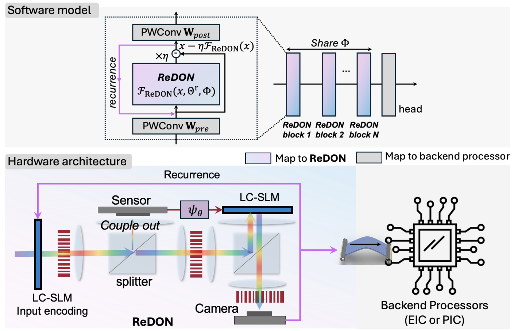
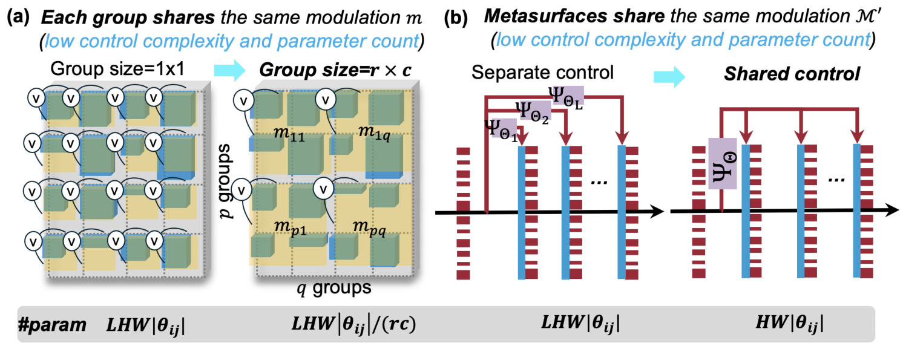

# ReDON: Recurrent Diffractive Optical Neural Processor with Reconfigurable Self-Modulated Nonlinearity

[返回图集](../README.md) · ReDON · ACM TODAES 2026 · 样本外补充

研究对象：专用加速器与可重构/存内计算平台 / ReDON循环衍射光学神经处理器（样本外补充）

18页作者发布的ACM TODAES期刊稿，DOI 10.1145/3840398；不是arXiv版，也不是CHORD。样本外补充，不计入固定100篇。仅收F2/F5，实验图不入库。

读图路径：F2 → F5。先问光学传播、光学感知和电子变换各在哪里，再问共享的是加工后的相位 Φ，还是调制函数的系数 Θ。两图展示对应关系与参数组织，不是实验结果。

可选后读：[F10(a)，物理p11](https://raw.githubusercontent.com/ScopeX-ASU/ScopeX-ASU.github.io/f5836099359bb3f1341c54efbd1751620590049f/files/publications/ONN_TODAES2026_Gu_ReDON.pdf#page=11) 是空间分组粒度的评估，仅作原文链接；不把某个配置的结果推广到全部共享策略。

作者发布入口：[ScopeX 论文列表](https://scopex-asu.github.io/publication.html)（同一固定 Git 提交中的 J30 条目链接此 PDF）。

版本与许可：[作者发布文件及固定版本](https://github.com/ScopeX-ASU/ScopeX-ASU.github.io/blob/f5836099359bb3f1341c54efbd1751620590049f/files/publications/ONN_TODAES2026_Gu_ReDON.pdf)，3,902,637字节、18个物理页。物理第1页可见 CC BY 4.0、作者版权声明和 DOI 10.1145/3840398。文内出版信息标 August 2026，卷期与文章号仍含占位信息；不声称与出版社最终字节相同，也不使用同名arXiv版替代。Git commit：`f5836099359bb3f1341c54efbd1751620590049f`；blob：`783f30764d3fb3da83fd5ed28996beb2ecc22c82`；源PDF SHA-256：`fd66071bbd88a0cb536552c8330f371b40377bc49d970b33f707ef826e97af69`。已目视核对首页、p4/p8整页和最终裁图，并核对图注及 §3–3.4；未发现这两图的第三方署名或单图许可例外。未审核其余图，不上传PDF。

## F2

**非实验图 · 软件与光电硬件的对应**

[原文物理页4](https://raw.githubusercontent.com/ScopeX-ASU/ScopeX-ASU.github.io/f5836099359bb3f1341c54efbd1751620590049f/files/publications/ONN_TODAES2026_Gu_ReDON.pdf#page=4) · [许可证 CC BY 4.0](https://creativecommons.org/licenses/by/4.0/)

先对照 Software model 与 Hardware architecture：光学核心由输入编码、被动超表面与光学传播承担，传感器读出中间光场的一部分，经轻量电子变换 Ψ 驱动调制平面。结合 §3、§3.3，循环复用同一加工好的超表面堆叠，Φ 在推理迭代间固定共享，而 Θ 可随通道和迭代更新；不要把训练时可优化的 Φ 理解为每轮重新加工。图注的 titlename 是排版占位符，不是模块名称。 样本外补充，不计入固定100篇覆盖。

署名：Ziang Yin, Qi Jing, Raktim Sarma, Zhaoran Rena Huang, Yu Yao, and Jiaqi Gu. ReDON: Recurrent Diffractive Optical Neural Processor with Reconfigurable Self-Modulated Nonlinearity. ACM TODAES 2026. DOI: https://doi.org/10.1145/3840398. Copyright 2026 held by the owner/author(s). Source: https://github.com/ScopeX-ASU/ScopeX-ASU.github.io/blob/f5836099359bb3f1341c54efbd1751620590049f/files/publications/ONN_TODAES2026_Gu_ReDON.pdf. Version: 18-page author-hosted ACM TODAES journal manuscript, August 2026, Git commit f5836099359bb3f1341c54efbd1751620590049f, blob 783f30764d3fb3da83fd5ed28996beb2ecc22c82; not the arXiv version; publisher-byte identity not asserted. CC BY 4.0: https://creativecommons.org/licenses/by/4.0/. Whole figure cropped from the exact author-hosted journal PDF and rasterized at 300 dpi; caption and adjacent figures/text excluded, all diagram labels and panels retained; no redrawing or recoloring. No endorsement implied.

修改说明：Whole figure cropped from the exact author-hosted journal PDF and rasterized at 300 dpi; caption and adjacent figures/text excluded, all diagram labels and panels retained; no redrawing or recoloring.

## F5

**非实验图 · 组内与跨层参数共享**

[原文物理页8](https://raw.githubusercontent.com/ScopeX-ASU/ScopeX-ASU.github.io/f5836099359bb3f1341c54efbd1751620590049f/files/publications/ONN_TODAES2026_Gu_ReDON.pdf#page=8) · [许可证 CC BY 4.0](https://creativecommons.org/licenses/by/4.0/)

F5(a) 把调制平面的像素划为组，组内共享 Ψ 的系数；F5(b) 则让多个被调制层共享系数，区别空间组内共享与跨层共享。结合 §3.4，练习：两种共享分别减少哪一个维度上的独立参数？底部参数表达式是结构计数，不是性能实测，也不说明所有共享设置效果相同。 样本外补充，不计入固定100篇覆盖。

署名：Ziang Yin, Qi Jing, Raktim Sarma, Zhaoran Rena Huang, Yu Yao, and Jiaqi Gu. ReDON: Recurrent Diffractive Optical Neural Processor with Reconfigurable Self-Modulated Nonlinearity. ACM TODAES 2026. DOI: https://doi.org/10.1145/3840398. Copyright 2026 held by the owner/author(s). Source: https://github.com/ScopeX-ASU/ScopeX-ASU.github.io/blob/f5836099359bb3f1341c54efbd1751620590049f/files/publications/ONN_TODAES2026_Gu_ReDON.pdf. Version: 18-page author-hosted ACM TODAES journal manuscript, August 2026, Git commit f5836099359bb3f1341c54efbd1751620590049f, blob 783f30764d3fb3da83fd5ed28996beb2ecc22c82; not the arXiv version; publisher-byte identity not asserted. CC BY 4.0: https://creativecommons.org/licenses/by/4.0/. Whole figure cropped from the exact author-hosted journal PDF and rasterized at 300 dpi; caption and adjacent figures/text excluded, all diagram labels and panels retained; no redrawing or recoloring. No endorsement implied.

修改说明：Whole figure cropped from the exact author-hosted journal PDF and rasterized at 300 dpi; caption and adjacent figures/text excluded, all diagram labels and panels retained; no redrawing or recoloring.
